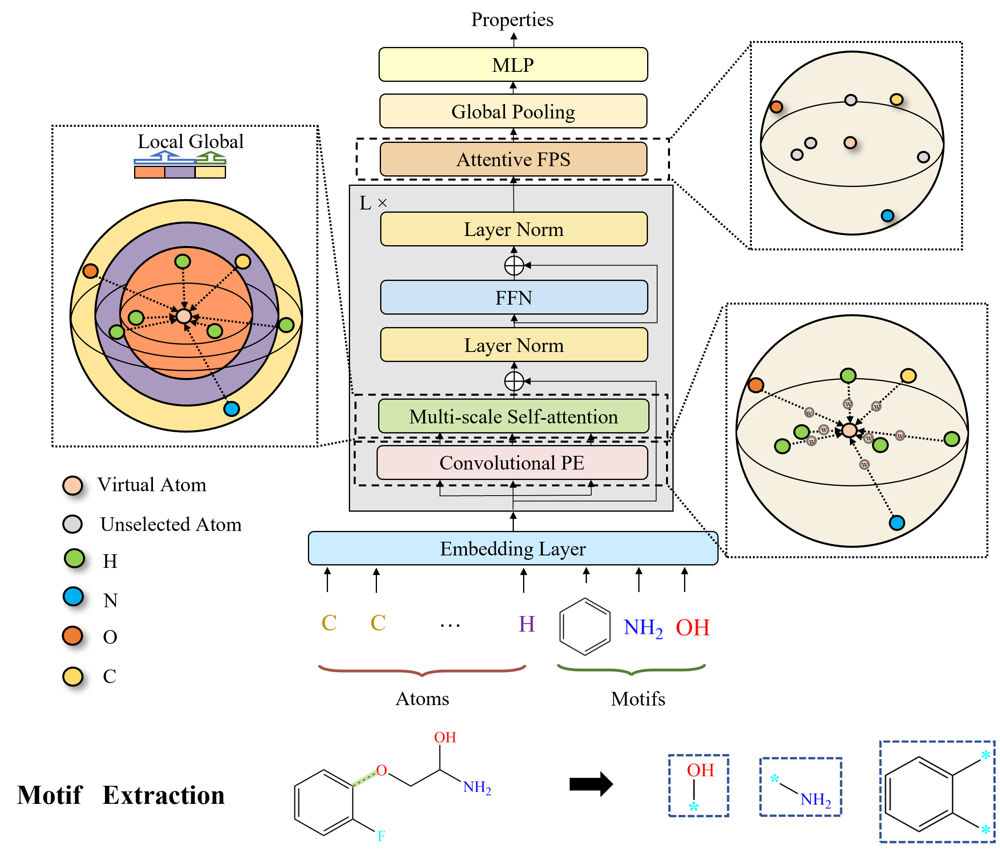

# Molformer

PyTorch implementation of **Molformer**, a Transformer for molecular property prediction that uses molecular motifs and 3D geometry.

Fang Wu, Dragomir Radev, and Stan Z. Li · AAAI 2023

[Paper](https://ojs.aaai.org/index.php/AAAI/article/view/25662) · [PDF](https://ojs.aaai.org/index.php/AAAI/article/download/25662/25434) · [Citation](#citation)



## Installation

From the repository root, install the model dependencies.

```bash
python -m pip install torch
```

Install `mendeleev` for optional elemental features in the MSA model and `rdkit` for motif extraction.

## Quick Start
Run this example from the repository root. Atom IDs are embedding indices, so the vocabulary size must exceed the largest ID. Index 0 is reserved for padding. Set `tgt` to the number of properties to predict.

```python
import torch
from model.tr_spe import build_model as build_spe
from model.tr_msa import build_model as build_msa

device = torch.device("cuda" if torch.cuda.is_available() else "cpu")
x = torch.tensor([[1, 1, 6, 8]], device=device)
pos = torch.tensor(
    [[[0., 0., 0.], [1., 0., 0.], [0., 1., 0.], [0., 0., 1.]]],
    device=device,
)
mask = x.ne(0).unsqueeze(1)

spe = build_spe(vocab=9, tgt=1).to(device).eval()
msa = build_msa(vocab=9, tgt=1, dist_bar=[1, 3, 5]).to(device).eval()

with torch.inference_mode():
    spe_out = spe(x, mask, pos)
    msa_out = msa(x, mask, torch.cdist(pos, pos))
```

## Models
- [`model/tr_spe.py`](model/tr_spe.py) — 3D-Transformer with Sinusoidal Position Encoding (SPE)
- [`model/tr_cpe.py`](model/tr_cpe.py) — 3D-Transformer with Convolutional Position Encoding (CPE)
- [`model/tr_msa.py`](model/tr_msa.py) — 3D-Transformer with Multi-scale Self-attention (MSA)
- [`model/tr_afps.py`](model/tr_afps.py) — 3D-Transformer with Attentive Farthest Point Sampling (AFPS)
- [`model/tr_all.py`](model/tr_all.py) — 3D-Transformer with CPE + MSA + AFPS

SPE takes 3D coordinates. CPE, MSA, AFPS, and the full model take pairwise distances. MSA and the full model also take distance thresholds (`dist_bar`). AFPS and the full model take a sample count (`k`).

## Datasets

### Quantum chemistry

- **QM7** — [Dataset](http://quantum-machine.org/datasets/) · [DeepChem loader](https://github.com/deepchem/deepchem/blob/master/deepchem/molnet/load_function/qm7_datasets.py#L30-L107) · [DeepChem docs](https://deepchem.readthedocs.io/en/latest/api_reference/moleculenet.html#qm7-datasets)
- **QM8** — [DeepChem loader](https://github.com/deepchem/deepchem/blob/master/deepchem/molnet/load_function/qm8_datasets.py) · [DeepChem docs](https://deepchem.readthedocs.io/en/latest/api_reference/moleculenet.html?highlight=qm7#qm8-datasets)
- **QM9** — [Dataset](https://ndownloader.figshare.com/files/3195389) · [DeepChem loader](https://github.com/deepchem/deepchem/blob/master/deepchem/molnet/load_function/qm9_datasets.py) · [ATOM3D](https://www.atom3d.ai/smp.html) · [MPNN supplement](https://drive.google.com/file/d/0Bzn36Iqm8hZscHFJcVh5aC1mZFU/view?resourcekey=0-86oyPL3e3l2ZTiRpwtPDBg) · [SchNetPack tutorial](https://schnetpack.readthedocs.io/en/stable/tutorials/tutorial_02_qm9.html#Loading-the-data)
- **GEOM-QM9** — [Dataset](https://doi.org/10.7910/DVN/JNGTDF) · [Loading tutorial](https://github.com/learningmatter-mit/geom/blob/master/tutorials/01_loading_data.ipynb)

### Physiology

- **BBBP** and **ClinTox** — Available through [MoleculeNet](https://moleculenet.org/datasets-1) and the [Molecules Dataset Collection](https://github.com/GLambard/Molecules_Dataset_Collection). See the [DeepChem MoleculeNet docs](https://deepchem.readthedocs.io/en/latest/api_reference/moleculenet.html) for dataset loaders.

### Biophysics

- **PDBbind** — See [ATOM3D](https://www.atom3d.ai/) for the split at 30% sequence identity.
- **BACE** — Available through [MoleculeNet](https://moleculenet.org/datasets-1) and the [Molecules Dataset Collection](https://github.com/GLambard/Molecules_Dataset_Collection).

### Materials science

- **COREMOF** — Used in the preceding 3D-Transformer work. [Dataset on Baidu Drive](https://pan.baidu.com/s/12N8gM8_TQ1mpBGx6gdkAog) (access code `l41s`).

The old PDBbind preprocessing and COREMOF reproduction scripts are absent from this checkout.

## Motif Extraction

Use an RDKit SMARTS query to find the atoms that match a motif. This example finds the carbonyl group in acetone.

```python
from rdkit import Chem

molecule = Chem.MolFromSmiles("CC(=O)C")
pattern = Chem.MolFromSmarts("C(=O)")
matches = molecule.GetSubstructMatches(pattern)
```

## Citation

```bibtex
@inproceedings{wu2023molformer,
  title = {Molformer: Motif-Based Transformer on {3D} Heterogeneous Molecular Graphs},
  author = {Wu, Fang and Radev, Dragomir and Li, Stan Z.},
  booktitle = {Proceedings of the AAAI Conference on Artificial Intelligence},
  year = {2023},
  volume = {37},
  number = {4},
  pages = {5312--5320},
  doi = {10.1609/aaai.v37i4.25662},
  url = {https://ojs.aaai.org/index.php/AAAI/article/view/25662}
}
```

## Contact

For questions or collaboration, contact [Fang Wu](mailto:fangwu97@stanford.edu).
